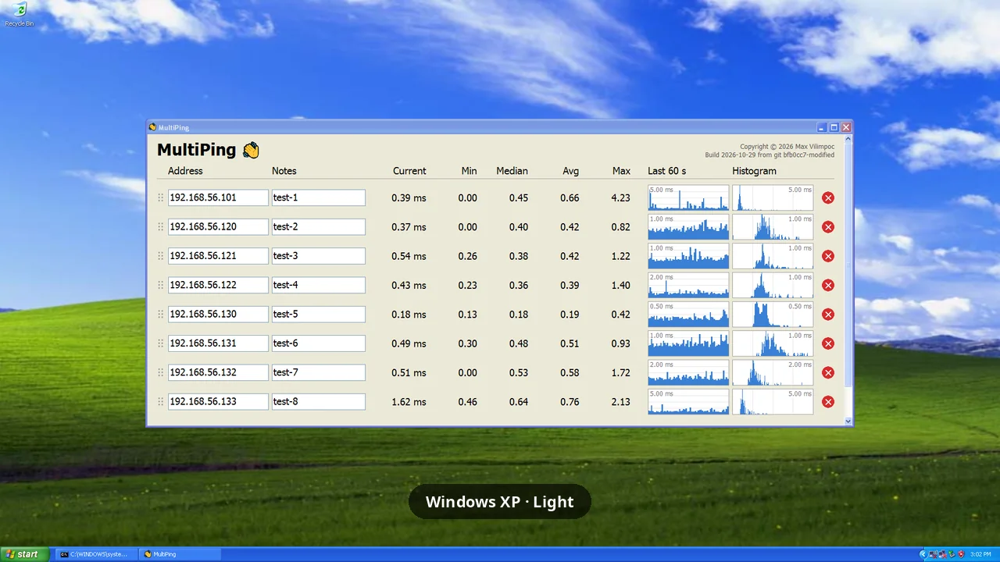

# MultiPing

A small tool that pings a list of hosts once a second and shows, per host, the current
round-trip time, session min / median / avg / max, and a bar graph of the last 60 seconds.

It runs on Windows (XP SP3 and later), macOS (11 and later) and Linux (GTK 3, Qt 5 or Qt 6),
with the same look everywhere and no extra dependencies.

  

## Which program?

| | Runs on | Built with | Size |
|---|---|---|---|
| `MultiPing.exe` | 64-bit Windows 7 SP1 and later | MSVC 14.44, current UCRT, static | about 313 KB |
| `MultiPingXP.exe` | 32- and 64-bit Windows XP SP3 and later | MinGW-w64 GCC (MSYS2 mingw32), msvcrt.dll | about 521 KB |
| `multiping-gtk` | Linux with GTK 3: Debian 12, Ubuntu 24.04 and later | g++ in Debian bookworm | about 164 KB |
| `multiping-qt5` | Linux with Qt 5.15 | g++ in Debian bookworm | about 176 KB |
| `multiping-qt6` | Linux with Qt 6.4 or later | g++ in Debian bookworm | about 180 KB |
| `MultiPing.app` | macOS 11 and later, Apple silicon and Intel | Apple clang, AppKit | about 408 KB |

The two Windows builds behave identically; every version-dependent feature is resolved at runtime,
and the XP build is the more portable of the two. On Linux, pick the kit the desktop uses: GTK on
GNOME, Qt on KDE.

## Usage

- Type a host name or IPv4/IPv6 address into a row and press Enter (or click elsewhere) to start pinging it.
- The Notes box beside it takes a name or anything else worth knowing about the host.
- The list always ends with an empty row for the next address. Filling it in adds another empty row below.
- Enter moves to the next row's address; Tab / Shift+Tab move through the boxes, the address then the notes.
- Escape reverts an edited box. The red circle at the right deletes the row.
- Drag the dots at a row's left up or down to move the row; dragged above or below the rows shown, the
  list scrolls along.
- Stats (min / median / avg / max) cover the whole session for that address; the graph shows the last 60 pings,
  one per second, with timeouts drawn in red.
- The window opens sized for 8 rows; a scrollbar appears only when there are more.
- The rows are saved to `addresses.txt` on every change and on exit, in `%APPDATA%\MultiPing` on Windows,
  `~/.config/MultiPing` on Linux and `~/Library/Application Support/MultiPing` on macOS: a line per row,
  the address, then a tab and the notes when there are any.
- The window size and position are saved to `window.txt` in the same folder and restored on the next
  start, clamped to the current screen if the display layout has changed. Under Wayland only the size is
  restored, as the window system places windows itself.
- The window follows the system's light or dark mode, also when it changes while the window is open: the
  app mode on Windows 10 1809 and later, the appearance on macOS, and the GTK or Qt theme on Linux.

Pinging needs no privileges. 

On Linux, it uses ICMP datagram sockets where `net.ipv4.ping_group_range`
allows them (systemd's default), and runs the system's `ping` where it does not (Ubuntu 24.04). 

On macOS, the first start asks for Local Network access, which pinging hosts on the LAN needs.

`MultiPing.app` is ad-hoc signed but not notarized, so macOS refuses to open a downloaded copy the first
time. Allow it with Open Anyway under System Settings › Privacy & Security (on macOS 14 and earlier,
Control-click the app and choose Open), or clear its quarantine flag in Terminal:
`xattr -dr com.apple.quarantine MultiPing.app`.

## Building

**Windows**: `build.bat` produces `MultiPing.exe`, a 64-bit build that requires Windows 7 SP1 or later,
statically linked against the C Runtime; its only imports are `user32`, `gdi32`, `kernel32`, `iphlpapi` and `ws2_32`.
`build_mingw.bat` produces `MultiPingXP.exe`, a 32-bit build that runs on Windows XP SP3 and later, using
MinGW-w64 GCC from MSYS2's `mingw32` environment (i686, linked against `msvcrt.dll`, static libgcc and
libstdc++).

**Linux**: `build_linux.sh` produces `multiping-gtk`, `multiping-qt5` and `multiping-qt6` in Docker's
Debian bookworm (`build_linux.Dockerfile`, built on first use), so they need nothing newer than glibc 2.36,
GTK 3.24, Qt 5.15 and Qt 6.4. `build_linux.sh --native` builds with the machine's own g++ for whichever of
GTK 3, Qt 5 and Qt 6 `pkg-config` finds.

**macOS**: `build_macos.sh` produces `MultiPing.app`, a universal (arm64 and x86_64) app with the Xcode
command line tools, ad-hoc signed.
