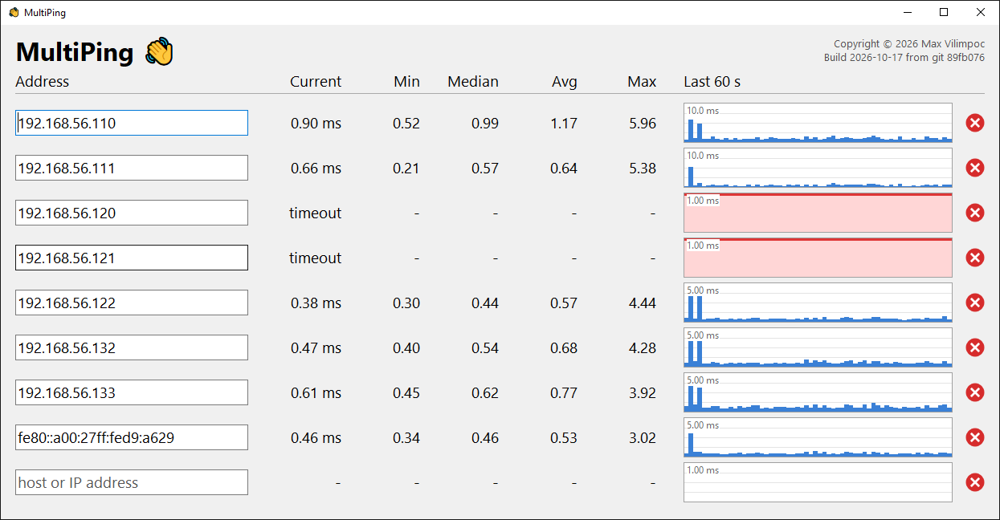

# MultiPing

A small Win32 tool that pings a list of hosts once a second and shows, per host, the current
round-trip time, session min / median / avg / max, and a bar graph of the last 60 seconds.

## Build

Run `build.bat` from a normal command prompt (it calls `vcvars64.bat` from VS 2022 Community itself).
Output is `MultiPing.exe`, statically linked against the CRT (`/MT`); its only imports are
`user32`, `gdi32`, `kernel32`, `iphlpapi` and `ws2_32`.
The build script embeds the current git short revision, shown under the copyright at the top right.
The application icon (`MultiPing.ico`) is generated from the Segoe UI Emoji waving hand by
`tools/make_icon.py` (needs Python with Pillow) and embedded via `MultiPing.rc`.

## Usage

- Type a host name or IPv4/IPv6 address into a row and press Enter (or click elsewhere) to start pinging it.
- The list always ends with an empty row for the next address. Filling it in adds another empty row below.
- Enter moves to the next row; Tab / Shift+Tab move between rows.
- Escape reverts an edited address box. The red circle at the right deletes the row.
- Stats (min / median / avg / max) cover the whole session for that address; the graph shows the last 60 pings,
  one per second, with timeouts drawn in red.
- The window opens sized for 8 rows; a scrollbar appears only when there are more.
- Addresses are saved to `%APPDATA%\MultiPing\addresses.txt` on every change and on exit.
- The window size and position are saved to `window.txt` in the same folder and restored on the next
  start, clamped to the current screen if the display layout has changed.

